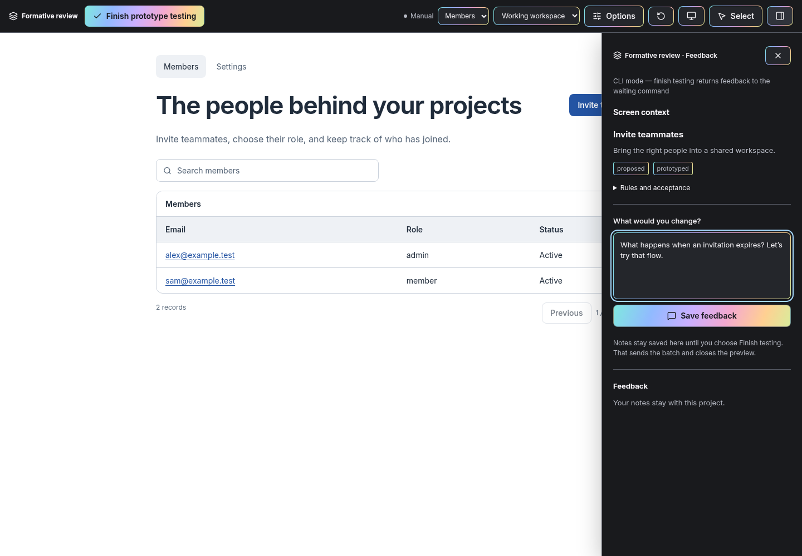
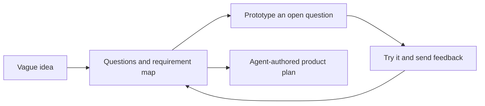

# Formative

**Discover what your app needs by talking it through—and trying it.**

Start with a vague app or website idea. Formative interviews you persistently, follows decisions into their consequences, proposes overlooked requirements, and uses interactive frontend prototypes when seeing an interface helps you decide. The result is a product plan shaped by what you actually want.



[Quick start](#quick-start) · [Install for your agent](https://github.com/lucapohl-angel/formative/blob/main/docs/installation.md) · [Discovery workflow](https://github.com/lucapohl-angel/formative/blob/main/docs/usage.md) · [Read the skill](https://github.com/lucapohl-angel/formative/blob/main/skills/formative/SKILL.md) · [Component design](https://github.com/lucapohl-angel/formative/blob/main/DESIGN.md) · [Contributing](https://github.com/lucapohl-angel/formative/blob/main/CONTRIBUTING.md)

[](https://github.com/lucapohl-angel/formative/actions/workflows/ci.yml)

## What is included

| Part | What it does |
| --- | --- |
| Relentless discovery skill | Tracks unresolved branches, asks dependency-aware questions with recommendations, and challenges vague assumptions. |
| Living requirements | Records capabilities, rules, dependencies, access, decisions, and their evidence—including areas not yet prototyped. |
| JSON-driven prototypes | Composes interactive screens from a validated catalog with consistent design tokens and simulated state. |
| Separate review controls | Select rendered elements, send anchored feedback, switch scenarios, and keep the prototype close to a real viewport. |
| Live feedback | A dedicated agent handles notes while the main conversation stays available. Valid revisions update the open preview. |
| Repeated self-critique | Reviews deliverables at least three times and continues improving when material issues remain. |

The interview adapts Matt Pocock's grilling and domain-modeling methods, with [pinned attribution and the original MIT notice](https://github.com/lucapohl-angel/formative/blob/main/skills/formative/references/upstream.md). You do not need Grill Me installed.

## Quick start

Use **Node.js 24+**. For Pi, install the package directly:

```bash
pi install npm:@koboimomo/formative
```

Run `/reload`, then `/formative` in your project. The package includes the extension and skill.

For Claude Code or Codex:

```bash
npm install -g @koboimomo/formative

# Claude Code
formative install-skill --agent claude
claude mcp add --scope user --transport stdio formative -- formative mcp

# Or Codex
formative install-skill --agent codex
codex mcp add formative -- formative mcp
```

Restart the agent, then invoke `/formative` in Claude Code or `$formative` in Codex. Install only the integration you use. The npm package includes built browser assets; no build step or Pi installation is required for Claude Code or Codex. [Installation, updates, and source setup](https://github.com/lucapohl-angel/formative/blob/main/docs/installation.md).

### Try the fictional demo

After the npm installation:

```bash
formative init --project .local/demo --fixture workspace
formative preview --project .local/demo --manual
```

Open the printed URL and keep the terminal running. Manual mode saves feedback but does not generate revisions itself. **Finish prototype testing** saves the checkpoint and stops the server. Reopen with `preview`; do not initialize the same project twice.

## Choose your agent

| Agent | Connection | Discovery and feedback |
| --- | --- | --- |
| Claude Code | Skill + local stdio MCP server | `/formative`; delegate the MCP feedback loop to a background agent. |
| Codex | Skill + local stdio MCP server | `$formative`; delegate the MCP feedback loop to a subagent when available. |
| Pi | Native package extension + skill | `/formative`; the preview owns a dedicated restricted Pi worker. |
| Other local agents | MCP tools or portable CLI + skill instructions | Host-managed feedback, or an explicit manual loop. |

Claude Code and Codex do **not** require Pi. The MCP server runs no model; the host agent processes feedback with its own tools and account. A worker must actively call `wait` to receive notes. If your host cannot keep a background worker active, feedback stays queued until an agent handles it—there is no universal idle-host wakeup. [Feedback and recovery](https://github.com/lucapohl-angel/formative/blob/main/docs/usage.md)

## Interview → prototype → learn → continue



1. Describe the idea. The agent maps major journeys, recommends choices, and explores missing behavior.
2. Follow the questions. Unknown, blocked, rejected, and explicitly deferred branches stay visible.
3. Try a prototype when it can answer a question. Ordinary clicks use local mock state; they do not call a model.
4. Send feedback. The worker updates the relevant prototype and behavioral requirements, preserving decisions and revision checks.
5. Finish that checkpoint. Return to the interview with what you learned; closing a preview does not finalize the plan.
6. Ask for the plan when ready. The agent writes a structure suited to the product, including unresolved issues if you requested an early draft.

## A prototype is a requirements rehearsal

Simulated login, payment, and saving are not real services. Prototype colors, typography, component choices, mock values, and layout do not prescribe the final implementation. You choose final design separately using your references and direction.

Generated snapshots live under `.formative/exports/`. They contain product records represented in the prototype, not every discovery note. The agent combines those records with the interview and unprototyped requirements to write `plan.md` or your chosen destination. Runtime exports never overwrite that written plan. Applied feedback is not blanket approval.

Project state, revision snapshots, feedback, and checkpoint handoffs live in the selected project's `.formative/` directory. Back it up with your project. The browser runs locally; feedback processed by an agent follows its provider's policy. [Security and data boundaries](https://github.com/lucapohl-angel/formative/blob/main/SECURITY.md)

## A coherent catalog, with room to extend

Components share typography, spacing, control geometry, states, and focus behavior. Specs use semantic variants rather than arbitrary CSS or executable HTML. Search the catalog and retrieve only the contracts you need:

```bash
formative catalog --query form
formative catalog --name Input
```

Project-local components can extend the catalog through a TSX implementation and validated manifest. They are trusted developer code, not an untrusted plugin sandbox. A catalog limitation must remain a prototype limitation; it must not silently remove a product requirement. [Component authoring](https://github.com/lucapohl-angel/formative/blob/main/skills/formative/references/components.md)

## Use it with Planboard

[Planboard](https://github.com/lucapohl-angel/planboard) provides a separate browser workspace for reviewing plans, diagrams, annotations, and approved versions. Finish discovery in Formative, then take the written plan into Planboard if useful. Either works independently.

## Development and limits

From a source checkout:

```bash
npm test
npm run catalog:check
npm run build
npx playwright install chromium
npm run test:browser
npm run check:release
```

Tests exercise validation, revision conflicts, worker lifecycle, Pi adapters, MCP feedback/disconnects, and browser behavior using temporary projects and fake workers. They do not make paid model calls or establish identical interview quality across models. CI is configured for Linux; macOS and Windows commands are provided but not yet end-to-end tested.

This is an early public release. The catalog cannot express every possible interface, simulations are not production backends, and a detached CLI cannot wake an idle agent. Agent behavior still depends on the host and model. [Architecture](https://github.com/lucapohl-angel/formative/blob/main/docs/architecture.md) · [Third-party credits](https://github.com/lucapohl-angel/formative/blob/main/docs/third-party.md)

**License:** [MIT](https://github.com/lucapohl-angel/formative/blob/main/LICENSE), with the bundled upstream skill attribution and third-party licenses preserved.
